<div align="center">



<br />

<p align="center">
  <a href="https://althaf786313.github.io/racing-game/">
    
  </a>
  <a href="https://althaf786313.github.io/racing-game/portfolio/">
    
  </a>
  
  
</p>

</div>

---

## Overview

**Road Rush — Sunset & Beyond** is a self-contained, zero-dependency **pseudo-3D arcade bike racing engine** built in pure **HTML5 Canvas**, **ES6 JavaScript**, and procedural **Web Audio API** sound synthesis. Choose from **5 distinct weather biomes**, weave through highway traffic at high speed, manage bike durability and **N₂O Nitro Boost**, and set new high scores across desktop or mobile.

---

## 5 Dynamic Biomes & Physics Profiles

Each track dynamically configures road surface grip, traffic density, atmospheric fog, procedural roadside scenery, and real-time weather particles:

| Track / Biome | Tagline | Difficulty | Grip Physics | Weather System | Traffic Density |
| :--- | :--- | :---: | :---: | :--- | :---: |
| **Sunset Highway** | *Coastal Palms & Warm Horizons* | Easy | `1.00` | Golden-hour clear skies | `0.8x` |
| **Neon Cyber City** | *Rain-Soaked Grid & Holograms* | Medium | `0.90` | Neon rain spray & speed grids | `1.2x` |
| **Desert Dust Storm** | *Red Canyons & Scorching Heat* | Hard | `0.82` | Swirling canyon sandstorm | `1.0x` |
| **Alpine Snow Pass** | *Icy Peaks & Treacherous Slips* | Extreme | `0.68` | Snowfall & low-traction ice drift | `0.7x` |
| **Midnight Thunder** | *Dark Forests & Lightning Strikes* | Hard | `0.85` | Headlight cone & lightning flashes | `1.1x` |

---

## Controls

| Action | Desktop Keyboard | Mobile / Touch HUD |
| :--- | :---: | :---: |
| **Accelerate** | `W` or `↑` | On-screen throttle |
| **Brake / Slow** | `S` or `↓` | On-screen brake |
| **Steer Left / Right** | `A` / `D` or `←` / `→` | Left / Right touch pads |
| **Activate Nitro (`N₂O`)** | `Space` | `N₂O` Cyan Boost button |
| **Mute / Unmute Synth Audio** | Top-right speaker button | Top-right speaker button |

---

## Technical Highlights

- **Procedural Pseudo-3D Road Projection:** Real-time perspective segment rendering with curves, hills, alternating rumble strips, speed zones, and horizon parallax.
- **Zero-Asset Web Audio Synthesizer (`AudioEngine`):** Generates dynamic engine RPM oscillators, filtered wind rush noise, collision impact feedback, and N₂O boost sound effects mathematically in browser memory — **0 external `.mp3`/`.wav` files**.
- **HUD Telemetry & Persistence:** Live digital speedometer, stage progress bar, hull integrity & regenerating nitro meters, plus persistent `localStorage` best-score tracking.
- **Included Developer Portfolio (`/portfolio`):** Also houses the interactive **Althaf Developer Portfolio & GitHub Upgrade Studio** ready for 1-click deployment to **Vercel** or **GitHub Pages**.

---

## Run Locally

No build tools or package installation required:

```bash
git clone https://github.com/althaf786313/racing-game.git
cd racing-game
python3 -m http.server 8080
```

- **Play Road Rush:** `http://localhost:8080/`
- **Open Developer Portfolio & GitHub Upgrade Studio:** `http://localhost:8080/portfolio/`

---

## Author

Built by **Althaf** ([@althaf786313](https://github.com/althaf786313))
